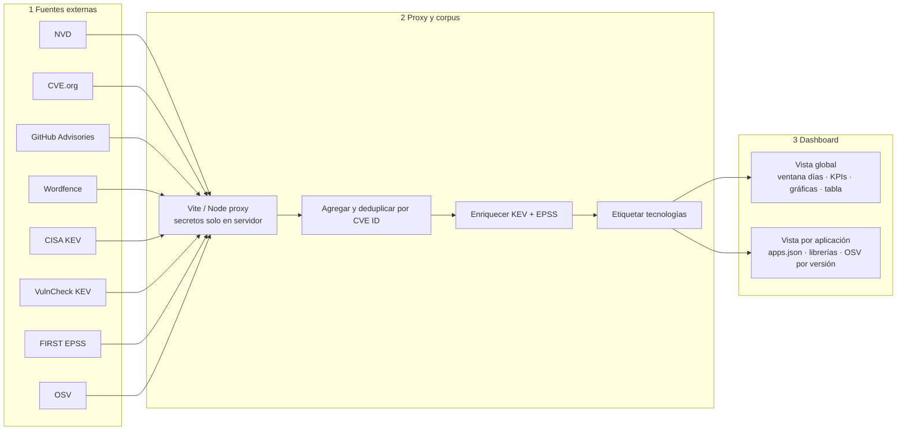

# NOC · CVE Watch

Dashboard tipo NOC (pantalla de pared) multi-tecnología: junta CVEs de varias fuentes, las etiqueta según el stack vigilado, quita duplicados por ID y las ordena por riesgo real (más crítico → menos crítico).

## Cómo funciona



El sitio opera en **tres capas**:

1. **Fuentes externas** — NVD, CVE.org, GitHub Advisories, Wordfence, CISA/VulnCheck KEV, FIRST EPSS y OSV. Cada una aporta un rol distinto (listado, enriquecimiento, score o match por versión).
2. **Proxy + corpus** — Vite/Node hacen de proxy (secretos solo en servidor). Se fusionan registros por CVE ID, se marcan KEV/EPSS y se etiquetan tecnologías. Si una fuente falla, el resto sigue y el pill **Fuentes** muestra el error.
3. **Dashboard** — dos modos de uso:
   - **Vista global** (sin aplicación): feed reciente por ventana (24 h → 90 d), KPIs, gráficas y tabla. Sirve para vigilancia NOC del día a día.
   - **Vista por aplicación** (selector **Aplicación**): cruza `config/apps.json` (runtime, framework, DBs, librerías) con el corpus + OSV por versión. Aparece el panel **Librerías**; las gráficas globales se ocultan porque el valor está en el riesgo del stack.

**Filtros clave**

| Control | Para qué sirve |
|---|---|
| Ventana (días) | En vista global recorta por fecha de publicación. Con app, CRITICAL/HIGH de libs pueden mantenerse aunque sean viejos. |
| Tecnologías | Acota por tags del catálogo (`Todas` = sin filtro de tech). |
| Solo explotadas | Solo CVE en KEV (CISA/VulnCheck). Si KEV está caído, la lista queda vacía. |
| Aplicación | Cambia a modo inventario: matching por libs/OSV del stack real. |

**Prioridad de riesgo (orden por defecto):** KEV → ransomware → EPSS → match de stack → severidad → CVSS.

## Fuente de verdad: `config/sources.json`

Un solo JSON controla:

| Sección | Qué define |
|---|---|
| `sources` | Fuentes de datos: `id`, `label`, `enabled`, `role`, **`baseUrl`**, `path`, `proxyPrefix`, `authEnv` |
| `technologies` | Lenguajes/tecnologías a vigilar (Magento, Java, Docker, Nginx, Redis, DBs, HTTP…) y sus keywords |
| `watchedPackages` | Inventario opcional para OSV (`ecosystem` + `name` + `version`) |
| `defaults` | Orden por riesgo (`sortBy` / `sortDir`) |

Inventario de aplicaciones TEL / Truper en línea: `config/apps.json` (selector **Aplicación** junto a Tecnologías). Al elegir una app se filtran CVEs por su runtime/framework/DBs y por nombres de librerías; si hay versiones parseables también alimenta OSV.

El proxy (Vite + `server/index.mjs`) y el frontend leen ese archivo. Tras editarlo:

```bash
npm run sync:sources   # copia a public/config/sources.json
```

(`predev` / `prebuild` ya lo hacen solos.)

**Secretos:** `NVD_API_KEY`, `GITHUB_TOKEN`, `VULNCHECK_TOKEN` y `WORDFENCE_API_KEY` viven en `.env`, no en el JSON.

**OSV (rol `match`):** no lista por fecha; cruza `watchedPackages` del JSON (`ecosystem` + `name` + `version`) con `/v1/querybatch`. Ejemplo:

```json
"watchedPackages": [
  { "ecosystem": "Packagist", "name": "magento/framework", "version": "103.0.4" },
  { "ecosystem": "npm", "name": "axios", "version": "1.6.0" }
]
```

**Red / QA:** el servidor debe poder salir por HTTPS a los `baseUrl` del JSON (sobre todo `https://api.first.org` para EPSS). Si el firewall bloquea FIRST, `/api/epss` responde **502** con un JSON que indica el host bloqueado; NVD/KEV pueden seguir en línea.

### Añadir o apagar una fuente

1. Edita la entrada en `sources` (`enabled: false` para apagarla).
2. Ajusta `baseUrl` + `path` si el upstream cambia.
3. Reinicia `npm run dev` / redespliega.

### Añadir una tecnología / lenguaje

Agrega un objeto en `technologies`:

```json
{ "id": "nodejs", "label": "Node.js", "keywords": ["node.js", "nodejs", "npm"] }
```

Para acotar la tabla a un stack, usa el selector de tecnologías (TEL, por tech o Todas).

| Fuente | Rol | Qué aporta | Credencial |
|---|---|---|---|
| **CVE.org** Search API | list | Fuente canónica del programa CVE (respaldo si NVD se atrasa) | — |
| **NVD (NIST)** API 2.0 | list | CVSS enriquecido, CWE, estado de análisis | `NVD_API_KEY` (opcional) |
| **GitHub Advisories** | list | Paquetes por ecosistema y GHSA sin CVE | `GITHUB_TOKEN` (opcional) |
| **OSV.dev** | match | Cruce por *paquete + versión* (npm, Packagist, Maven…) | — |
| **ENISA EUVD** | enrich | Respaldo UE ante inestabilidad NVD/CVE | — |
| **Wordfence Intelligence** | list | Plugins/temas WordPress poco cubiertos en NVD | `WORDFENCE_API_KEY` |
| **CISA KEV** | enrich | Explotadas activamente (catálogo federal) | — |
| **VulnCheck KEV** | enrich | KEV ampliado (mayor cobertura que CISA) | `VULNCHECK_TOKEN` |
| **FIRST EPSS** | score | Probabilidad de explotación a 30 días | — |

**Prioridad (orden por defecto):** KEV > ransomware > EPSS > match de stack > severidad > CVSS.  
**Fusión:** CVE.org pisa a NVD en CVSS/descripción; CISA KEV pisa a VulnCheck en el flag `kev`.

## Uso

```bash
npm i
cp .env.example .env        # opcional: NVD_API_KEY, GITHUB_TOKEN, VULNCHECK_TOKEN, WORDFENCE_API_KEY
npm run dev                 # http://localhost:5173
```

Producción (Node ≥ 20, sin dependencias extra):

```bash
npm run build && npm start  # http://localhost:8080 — sirve dist/ y hace de proxy con caché de 60 s
```

El browser usa el mismo esquema de la URL con la que abriste la app (`http://host:8082/` o `https://...`).
Las fuentes externas (`baseUrl` en `sources.json`) siempre van por **HTTPS** vía el proxy.

Para servir la app misma en HTTPS (opcional):

```bash
npm run tls:init              # PEM autofirmados en certs/
# o TLS_CERT=/ruta/cert.pem TLS_KEY=/ruta/key.pem
PORT=8082 npm start           # entonces sí: https://host:8082/
```

Sin PEM, el proceso escucha **HTTP** — abre `http://host:8082/`, no https.

Modo demo, sin internet o si la red corporativa bloquea alguna fuente:

```bash
npm run mock                # terminal 1: simula las 4 APIs en :4010
npm run dev:mock            # terminal 2
```

## Arquitectura

Ver el diagrama Mermaid de la sección **Cómo funciona**. En código:

```
config/sources.json         SSOT: fuentes (URL base) + tecnologías + defaults
config/apps.json            inventario de apps (runtime / framework / DBs / libs)
public/config/*.json        copias servidas al browser (sync)
proxy.config.mjs            arma upstreams desde el JSON
src/
  config/       schema + loader
  sources/      nvd · cveorg · github · osv · euvd · wordfence · kev · vulncheckKev · epss
  lib/          aggregate · resolveAppStack · matchLibraries · matchTechnologies · http
  hooks/        useCves · useSourcesConfig · useAppsConfig
  store/        filters (Zustand + persist)
  components/   KpiRow · FiltersBar · CveTable · LibraryRiskPanel · SourceStatus · …
```

- Las llaves de API solo viven en el proxy y nunca llegan al bundle.
- Cada fuente se consulta por separado: si una falla, las demás siguen y el panel *Estado de fuentes* muestra el error (tooltip con `baseUrl`).
- El proxy de producción reenvía GET y POST (necesario para OSV `querybatch`).
- La severidad se muestra con icono y texto, no solo con color.
