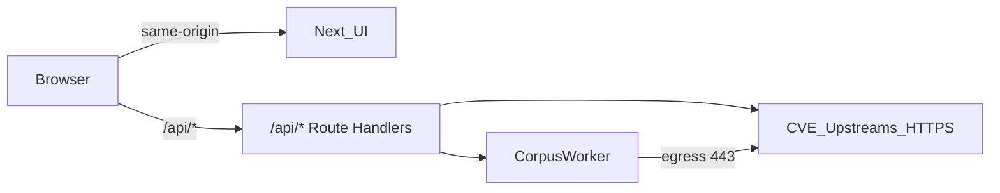

# NOC · CVE Watch (Next.js)

Dashboard NOC multi-tecnología: corpus CVE en el servidor, UI same-origin, deploy Docker en Truper.

## Arquitectura



- El **browser no habla** con NVD/GitHub/etc. Solo con el host del dashboard.
- El **contenedor** hace egress HTTPS a las fuentes (ver sección FortiGuard abajo).

## Arranque (local y server)

**Un solo flujo:** Docker en `:8082`. El build de la imagen hace `next build` + corpus.

```bash
cp .env.example .env   # solo la primera vez; ajusta user/pass y tokens
npm ci                 # local / server con Node (para los scripts npm)
npm run dev            # docker compose up --build  → http://localhost:8082
```

### Server Truper (tras `git pull`)

```bash
git pull
npm run deploy         # docker compose up --build -d
# http://172.20.5.212:8082
```

Equivalente sin npm: `docker compose up --build -d`.

Health (con sesión):

```bash
curl -sS -b cookies.txt "http://127.0.0.1:8082/api/corpus/health"
```

Volúmenes: `certs/` (CA Forti opcional) y volumen Docker `data/` (snapshot corpus).

## Scripts

| Script | Uso |
|--------|-----|
| `npm run dev` | Docker Compose en primer plano (`:8082`) |
| `npm run deploy` | Igual, detached (server / QA) |
| `npm run dev:next` | Next hot-reload en el host `:3000` (sin Docker) |
| `npm run build` / `start` | Build/start Next fuera de Docker |
| `npm run sync:sources` | `config/` → `public/config/` |
| `npm run bundle:corpus` | Genera `server/corpus/ingest.bundle.mjs` |

## Cliente HTTP (front)

Todo el consumo de API del browser pasa por paths relativos:

- [`src/lib/api/client.ts`](src/lib/api/client.ts) — `apiGet` / `apiPost`
- [`src/lib/api/corpus.ts`](src/lib/api/corpus.ts) — `/api/corpus*`
- Proxies de fuentes vía `/api/{source}/...` (Route Handler)

## Egress / FortiGuard (para Seguridad)

**Origen:** contenedor `cve_dashboard` (Docker Compose, subnet `10.250.250.0/24`).  
**Protocolo:** solo HTTPS `:443` (lectura de APIs públicas de vulnerabilidades).  
**No** es navegación de usuarios finales hacia esos hosts.

Hosts a liberar (Web Filter). Si hay SSL Inspection, excluir también o confiar el CA con `NODE_EXTRA_CA_CERTS=/app/certs/corp-ca.pem`:

| Fuente | Host | Rol | Token |
|--------|------|-----|-------|
| NVD | `services.nvd.nist.gov` | list | `NVD_API_KEY` opcional |
| GitHub Advisories | `api.github.com` | list | `GITHUB_TOKEN` opcional |
| CVE.org | `www.cve.org` | list | — |
| CIRCL | `vulnerability.circl.lu` | list | — |
| Red Hat | `access.redhat.com` | list | — |
| CISA KEV | `www.cisa.gov` | enrich | — |
| ENISA EUVD | `euvdservices.enisa.europa.eu` | enrich | — |
| VulnCheck KEV | `api.vulncheck.com` | enrich | `VULNCHECK_TOKEN` requerido |
| Wordfence | `www.wordfence.com` | list | `WORDFENCE_API_KEY` requerido |
| OSV | `api.osv.dev` | match | — |
| FIRST EPSS | `api.first.org` | score | — |
| Microsoft MSRC | `api.msrc.microsoft.com` | list (cvrf) | — |
| Cisco CSAF | `www.cisco.com` | list (csaf) | — |
| Palo Alto | `security.paloaltonetworks.com` | list | — |
| Oracle CSAF | `www.oracle.com` | list (csaf) | — |
| Broadcom/VMware | `support.broadcom.com` | list | — |
| Kubernetes CVE feed | `kubernetes.io` | list (jsonfeed) | — |
| Jenkins Update Center | `updates.jenkins.io` | match | — |
| SUSE CSAF | `ftp.suse.com` | enrich (off) | — |
| CERT-Bund WID | `wid.cert-bund.de` | list (csaf) | — |
| Fortinet IR | `filestore.fortinet.com` | list (rss) | — |
| Ivanti | `www.ivanti.com` | list (rss) | — |
| Node.js vulns | `nodejs.org` | list (rss) | — |
| GitLab security | `about.gitlab.com` | list (rss) | — |
| AWS bulletins | `aws.amazon.com` | list (rss) | — |
| GCP bulletins | `docs.cloud.google.com` | list (atom) | — |
| Maven Central | `repo1.maven.org` | catalog | — |
| npm | `registry.npmjs.org` | catalog | — |
| PyPI | `pypi.org` | catalog | — |
| Go proxy | `proxy.golang.org` | catalog | — |

SSOT de fuentes: [`config/sources.json`](config/sources.json).  
PSIRT fabricante: proxy same-origin listo. **Ingesta al corpus (tier 1):** MSRC (`cvrf`), Kubernetes (`jsonfeed`), Palo Alto (`json`). Pendiente: CSAF/RSS/Atom y resto de fabricantes.

## Auth

Cookie HttpOnly `noc_cve_session` (JWT HS256). Credenciales: `DASHBOARD_USER` / `DASHBOARD_PASS`. Opcional `SESSION_SECRET`.

## Netlify

No es el runtime del producto (no ejecuta corpus/proxy). Usar Docker/Truper para operación real.
